<div align="center">

# 🗳️ Conference — 전학대회 실시간 의결 시스템

**종이 투표와 수기 집계 없이, 스마트폰 하나로 진행하는 전체학생대표자회의**

출석 체크부터 안건 상정, 실시간 투표, 결과 공개까지 회의의 전 과정을 웹으로 운영합니다.

[](#)
[](#)
[](#)
[](#)
[](#)
[](#)
[](#)
[](#)

<!-- 🔗 서비스 주소: https://conference.momentum57.cloud -->

</div>

<br>

## 📌 목차

1. [프로젝트 소개](#-프로젝트-소개)
2. [주요 기능](#-주요-기능)
3. [화면 구성](#-화면-구성)
4. [회의 진행 흐름](#-회의-진행-흐름)
5. [기술 스택](#-기술-스택)
6. [시스템 아키텍처](#-시스템-아키텍처)
7. [핵심 구현 포인트](#-핵심-구현-포인트)
8. [ERD](#-erd)
9. [API 개요](#-api-개요)
10. [프로젝트 구조](#-프로젝트-구조)
11. [실행 방법](#-실행-방법)
12. [부하 테스트](#-부하-테스트)
13. [팀원 및 역할](#-팀원-및-역할)

<br>

## 📖 프로젝트 소개

**전학대회(전체학생대표자회의)** 는 각 단위(학과·단과대 등)의 대표자들이 모여 학생 자치의 주요 안건을 의결하는 회의입니다. <br>
기존에는 종이 명부로 출석을 확인하고, 거수나 종이 투표로 의결한 뒤 사람이 직접 표를 세는 방식이었기 때문에 다음과 같은 문제가 있었습니다.

| 기존 방식의 문제 | Conference의 해결 방법 |
| --- | --- |
| 출석 확인과 정족수 계산을 수기로 진행 | 관리자 화면에서 클릭으로 출석 처리, **개의 정족수 자동 계산** |
| 안건마다 의결권자 명단을 다시 정리 | 안건 상정 시 **출석 + 의결권 보유자만 자동으로 투표권 부여** |
| 집계에 시간이 걸리고 오류 가능성 존재 | 대의원이 휴대폰으로 투표하면 **즉시 서버에서 집계** |
| 참관인·대의원이 진행 상황을 알기 어려움 | **SSE 기반 실시간 상태 동기화** 로 모든 화면이 동시에 전환 |

> 관리자(의장단)는 PC로 회의를 진행하고, 대의원은 모바일 웹으로 투표하며, 누구나 공개 출석 현황 페이지에서 참석 현황을 확인할 수 있습니다.

<br>

## ✨ 주요 기능

### 👤 대의원 (모바일)
- **로그인 / 비밀번호 변경** — JWT 기반 인증
- **실시간 회의 상태 확인** — `의결 준비 중 → 의결 중 → 의결 종료` 화면이 관리자 조작에 맞춰 자동 전환
- **찬성 · 반대 · 기권 투표** — 투표 변경 및 취소 가능
- **의결권 안내** — 불참 상태이거나 의결권이 없는 단위(비대위 등)는 안내 문구 표시

### 🛠️ 관리자 (PC)
- **출석 관리** — 단위별 명부에서 출석 토글, 재적·출석 인원과 **개의 정족수** 실시간 표시
- **회원(명부) 관리** — 단위(학과) 및 대의원 등록·삭제, 의결권 유무 설정
- **안건 관리** — 안건 생성 시 **일반 정족수(1/2) / 특별 정족수(2/3)** 선택, 개의 정족수 미달 시 의결 시작 불가
- **의결 진행** — 회의 상태(`PROGRESS` / `STOP` / `VOTING` / `RESULT`) 전환
- **결과 화면** — 찬성·반대·기권 집계와 의결권 수를 전면 스크린용 화면으로 표시
- **안건 목록** — 지난 안건과 결과 이력 조회

### 🌐 공개 출석 현황 페이지
- 로그인 없이 단위별 출석 현황과 출석 인원 확인
- 이름 검색 지원

<br>

## 🖼️ 화면 구성

| 대의원 로그인 | 대의원 투표 화면 | 공개 출석 현황 |
| :---: | :---: | :---: |
| 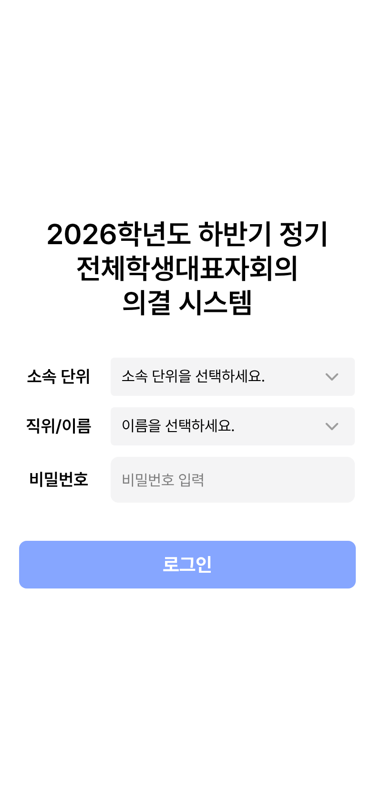 | 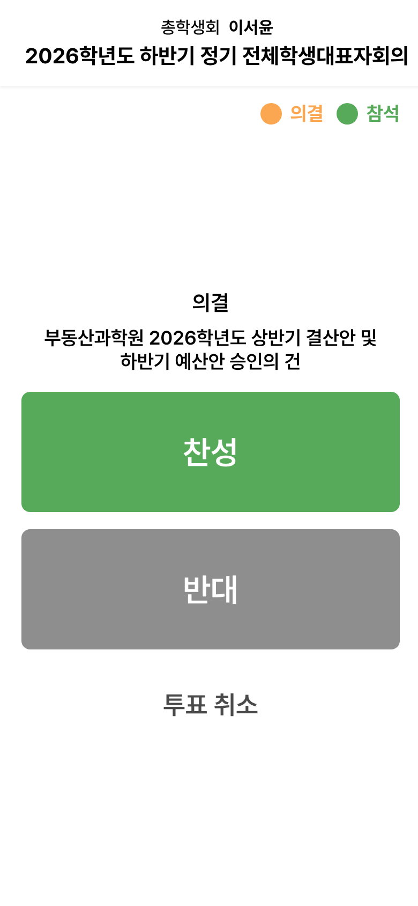 | 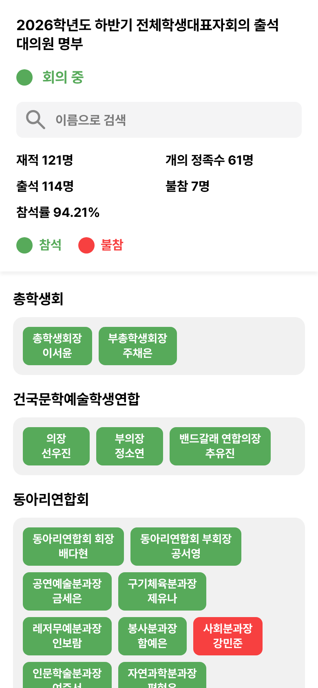 |

| 관리자 출석 관리 | 관리자 안건 의결 | 결과 화면 |
| :---: | :---: | :---: |
| 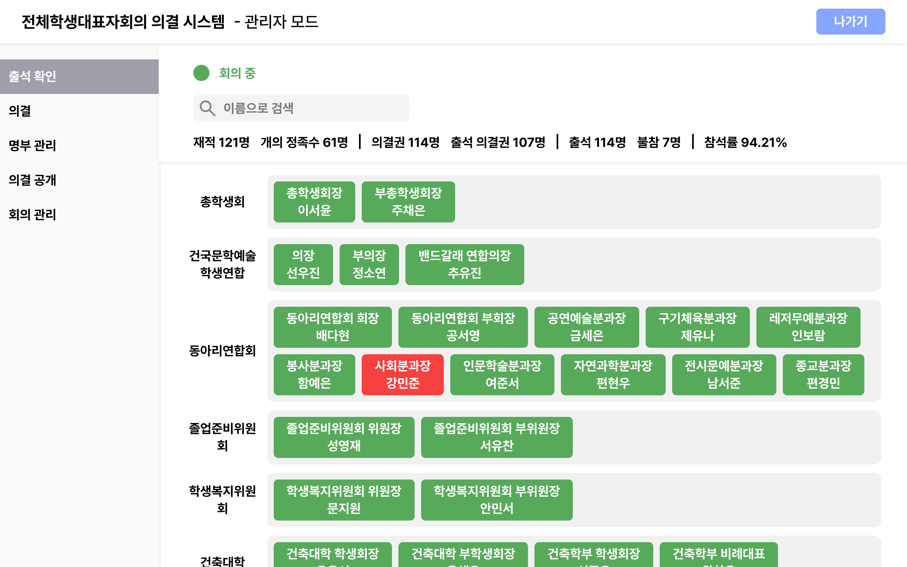 | 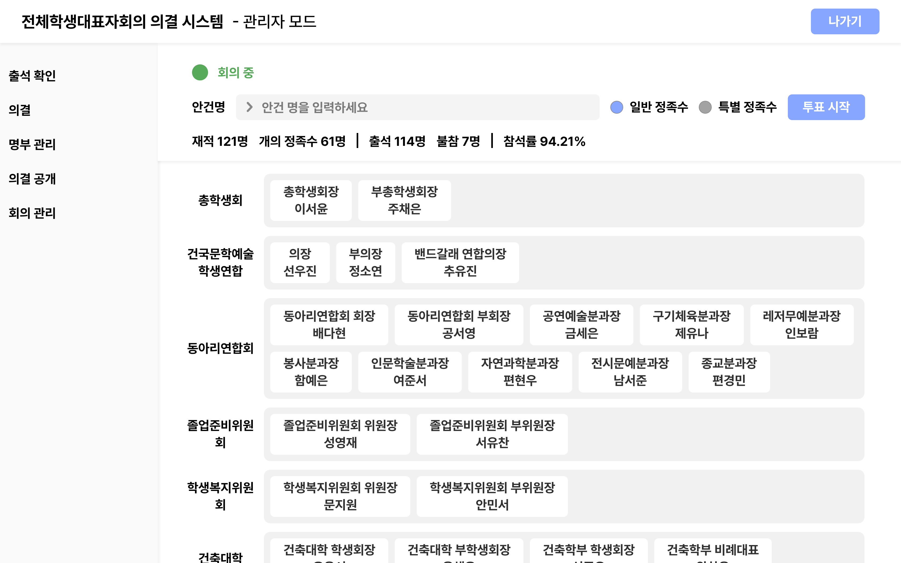 | 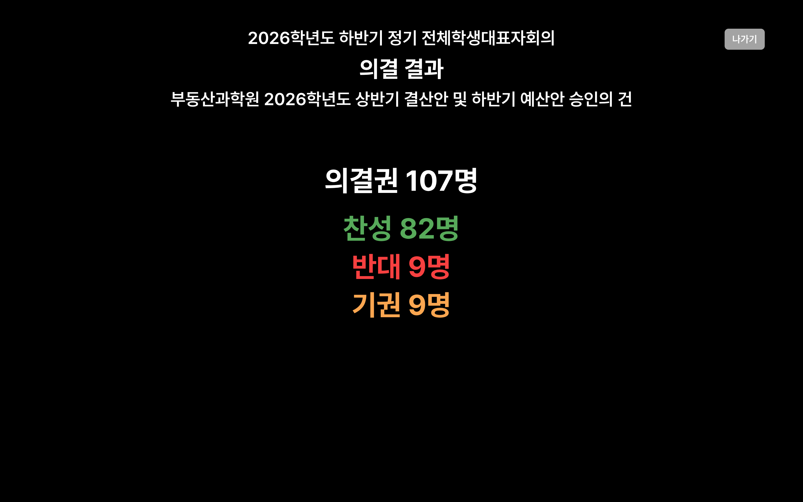 |

| 회원(명부) 관리 | 안건 목록 | 투표 진행 중 집계 |
| :---: | :---: | :---: |
| 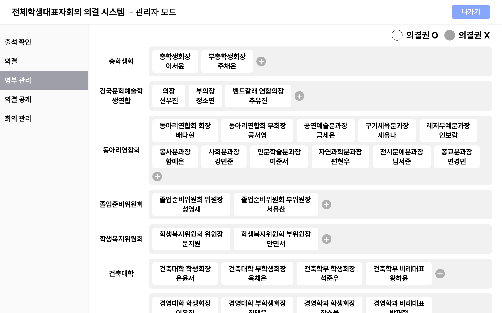 | 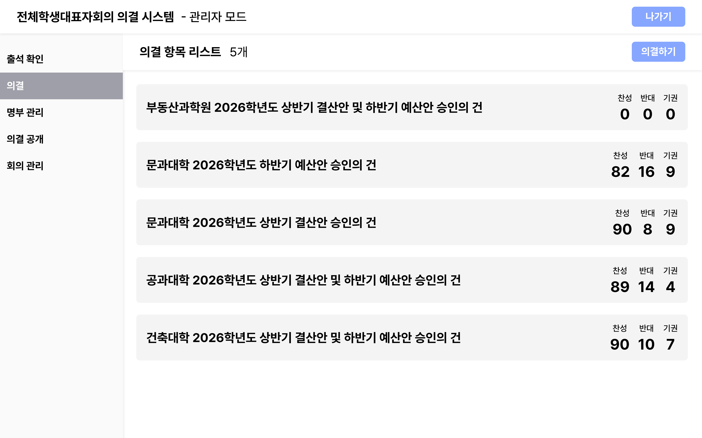 | 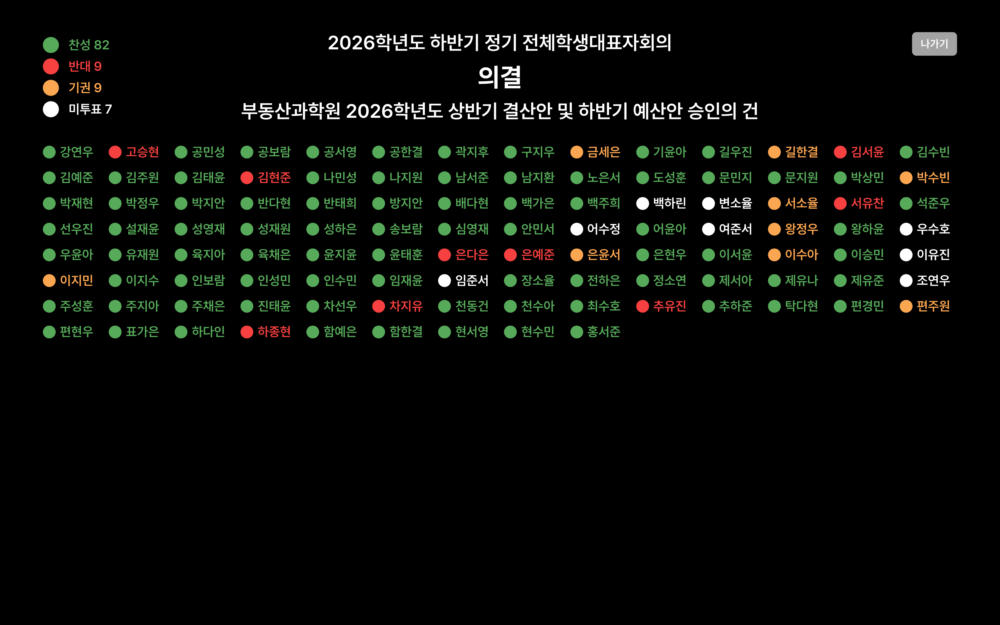 |

<br>

## 🔄 회의 진행 흐름

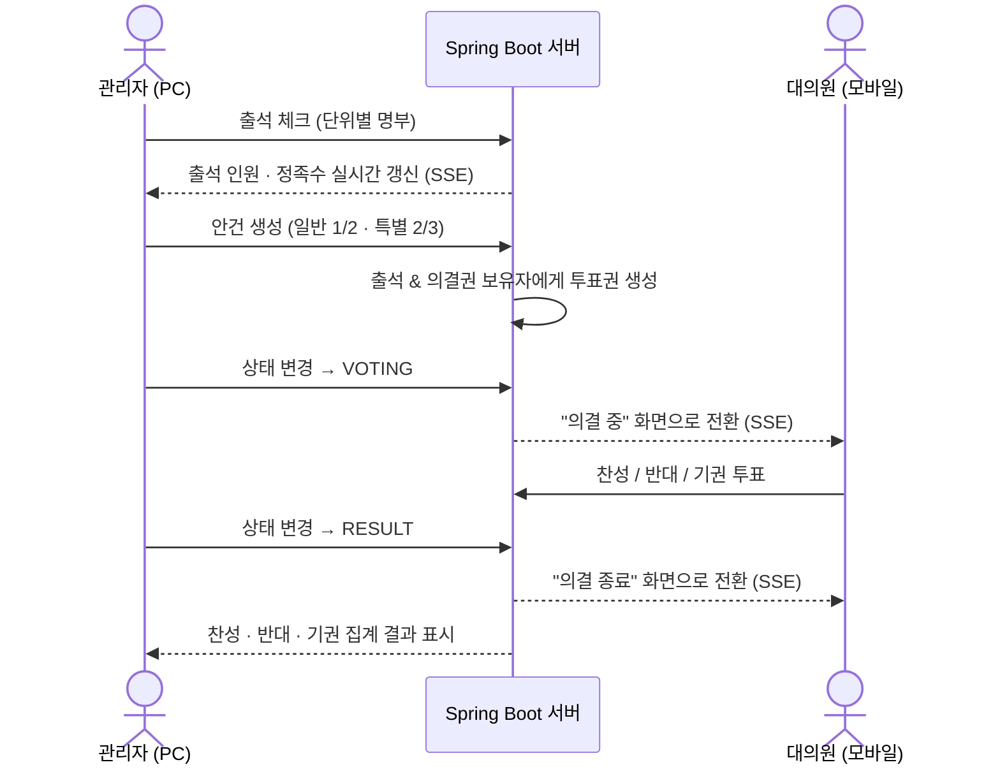

<br>

## 🧰 기술 스택

| 구분 | 기술 |
| --- | --- |
| **Frontend** | React 19, TypeScript, Vite 7, Tailwind CSS 4, React Router 7, Axios, Headless UI |
| **Backend** | Java 17, Spring Boot 4, Spring Data JPA, Spring Security, JWT (jjwt), Lombok, Springdoc OpenAPI(Swagger) |
| **Database** | MySQL / MariaDB |
| **Realtime** | Server-Sent Events (SSE) |
| **Infra** | Vercel (Frontend), AWS EC2 (Backend) |
| **Test** | k6 부하 테스트 |
| **Tooling** | ESLint, Prettier, Gradle, IntelliJ IDEA |

<br>

## 🏗️ 시스템 아키텍처

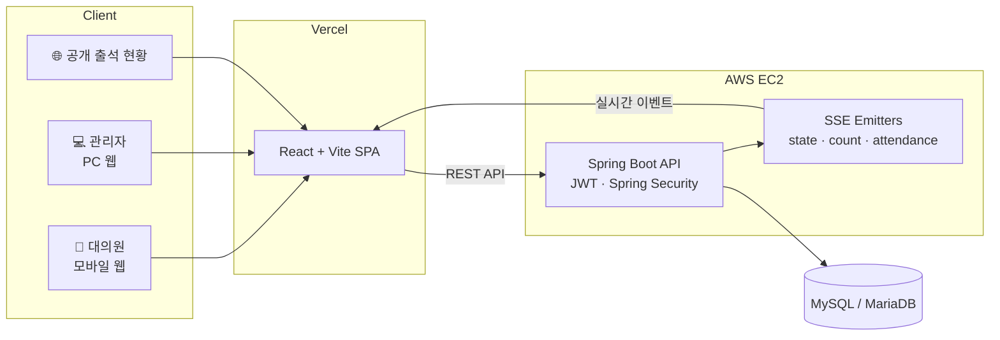

<br>

## 💡 핵심 구현 포인트

### 1. SSE를 이용한 실시간 상태 동기화
회의 상태, 출석 인원, 출석 명단이 바뀔 때마다 서버가 연결된 모든 클라이언트에 이벤트를 전송합니다.
WebSocket 대신 **단방향 통신에 충분하고 구현이 가벼운 SSE** 를 선택했습니다.

| 스트림 | 용도 |
| --- | --- |
| `GET /state/stream` | 회의 상태(`PROGRESS`/`STOP`/`VOTING`/`RESULT`) 및 현재 안건 |
| `GET /user/count/stream` | 재적 · 출석 인원 수 |
| `GET /user/attendance/stream` | 출석 명단 변경 |

프론트엔드에서는 `UserRealtimeContext`, `ManagerRealtimeContext` 로 스트림을 구독해 여러 화면이 같은 상태를 공유합니다.

### 2. 중복 투표 방지와 동시성 제어
- **안건 × 대의원** 마다 하나의 투표권(`Attendance`)만 존재하도록 유니크 제약(`agenda_id, user_id`)을 걸었습니다.
- **투표권 하나당 투표 1개**(`Vote.attendance_id` 유니크)만 저장되며, 다시 투표하면 기존 표의 값을 변경합니다.
- 투표 시 비관적 락(`SELECT ... FOR UPDATE`)으로 투표권을 조회해 **동시 요청에서도 표가 중복 생성되지 않도록** 처리했습니다.
- 서버는 회의 상태가 `VOTING` 이고 현재 안건이 설정된 경우에만 투표를 받습니다.
- 프론트엔드에서도 요청 잠금(ref)으로 연타·중복 클릭을 막았습니다.

### 3. 의결권 자동 부여
안건이 상정되면 **출석 상태이면서 의결권이 있는 대의원** 에게만 투표권이 생성됩니다.
불참자나 의결권이 없는 단위는 투표 화면 대신 안내 문구가 표시됩니다.

### 4. 역할 기반 인증 (JWT + Spring Security)
- 대의원 / 관리자 로그인을 분리하고, 토큰의 `role` 클레임으로 권한을 구분합니다.
- 관리 API(`/agenda/**`, `/state/**`, `/user/**` 등)는 `ADMIN` 권한만 접근할 수 있습니다.
- 비밀번호는 BCrypt로 암호화해 저장합니다.
- 프론트엔드 라우터에서도 `ManagerAuthGuard` 로 관리자 페이지 접근을 막습니다.

### 5. 실제 회의 규모를 고려한 부하 테스트
k6로 **약 150명이 동시에 조회·투표하는 상황** 을 시뮬레이션해 실제 회의 전에 서버 안정성을 검증했습니다. ([부하 테스트](#-부하-테스트) 참고)

<br>

## 🗂️ ERD

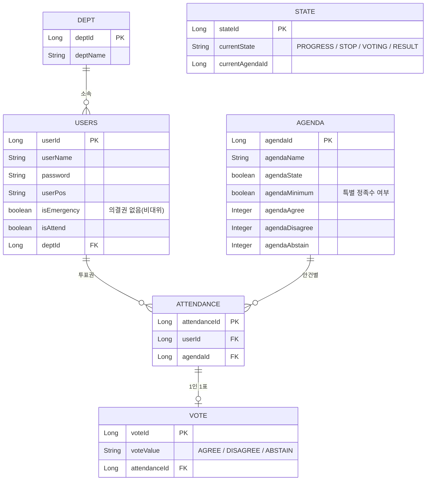

<br>

## 📡 API 개요

> 전체 명세는 서버 실행 후 Swagger UI(`/swagger-ui.html`)에서 확인할 수 있습니다.

| 도메인 | Method | Endpoint | 설명 | 권한 |
| --- | --- | --- | --- | --- |
| User | POST | `/user/login` | 대의원 로그인 | 전체 |
| User | POST | `/user/admin-login` | 관리자 로그인 | 전체 |
| User | GET | `/user/me` | 내 정보 조회 | 로그인 |
| User | POST | `/user/password` | 비밀번호 변경 | 로그인 |
| User | PATCH | `/user/attendance/{id}` | 출석 토글 | 관리자 |
| User | GET | `/user/count` | 재적 · 출석 인원 | 관리자 |
| Dept | GET | `/dept` | 단위 목록 | 전체 |
| Agenda | POST | `/agenda` | 안건 생성 | 관리자 |
| Agenda | PUT | `/agenda/close/{id}` | 안건 종료 | 관리자 |
| Attendance | POST | `/attendance` | 안건별 투표권 생성 | 관리자 |
| State | GET | `/state` | 현재 회의 상태 | 전체 |
| State | POST | `/state` | 회의 상태 변경 | 관리자 |
| Vote | POST | `/vote/cast` | 투표하기 | 로그인 |
| Vote | POST | `/vote/cancel` | 투표 취소 | 로그인 |
| Vote | GET | `/vote/result/{agendaId}` | 안건 결과 집계 | 로그인 |

<br>

## 📁 프로젝트 구조

```
conference3
├── frontend/                  # React + Vite
│   └── src/
│       ├── apis/              # axios 인스턴스, API 타입
│       ├── hooks/             # 도메인별 API 훅 (user, agenda, vote, attendance, state, dept)
│       ├── contexts/          # SSE 실시간 상태 Context (대의원 / 관리자)
│       ├── components/        # 공통 UI 컴포넌트 (버튼, 팝업, 콤보박스 등)
│       ├── layouts/           # 관리자 레이아웃 (TopBar, SideBar)
│       ├── pages/             # 로그인, 대의원 홈, 공개 출석 현황
│       │   └── manager/       # 출석, 회원, 안건, 안건 목록, 결과, 설정
│       └── router/            # 라우팅 및 관리자 접근 가드
│
├── backend/                   # Spring Boot
│   └── src/main/java/com/example/conference/
│       ├── user/              # 회원, 로그인, 출석 SSE
│       ├── dept/              # 단위(학과)
│       ├── agenda/            # 안건
│       ├── attendance/        # 안건별 투표권
│       ├── vote/              # 투표 및 집계
│       ├── state/             # 회의 상태 및 상태 SSE
│       └── security/          # Spring Security, JWT
│
└── load-tests/                # k6 부하 테스트 스크립트
```

<br>

## 🚀 실행 방법

### 사전 준비
- Node.js 20+
- Java 17
- MySQL 또는 MariaDB

### Backend

```bash
cd backend
```

`src/main/resources/application.properties` 에 DB 정보를 설정합니다.

```properties
spring.datasource.url=jdbc:mysql://localhost:3306/conference?serverTimezone=Asia/Seoul
spring.datasource.username=YOUR_DB_USER
spring.datasource.password=YOUR_DB_PASSWORD
spring.jpa.hibernate.ddl-auto=update
```

```bash
./gradlew bootRun
```

서버는 기본적으로 `http://localhost:8080` 에서 실행됩니다.

### Frontend

```bash
cd frontend
npm install
```

`.env.development` 에 API 주소를 설정합니다.

```env
VITE_API_BASE_URL=http://localhost:8080
```

```bash
npm run dev
```

브라우저에서 `http://localhost:5173` 으로 접속합니다.

<br>

## 📊 부하 테스트

실제 전학대회 규모(약 150명)를 기준으로 [k6](https://k6.io/) 테스트를 작성했습니다.

| 스크립트 | 내용 |
| --- | --- |
| `smoke.js` | 서버 연결 빠른 확인 |
| `read-150.js` | 관리자 조회 API에 150명 동시 접속 |
| `vote-150.js` | 안건 생성 → `VOTING` 전환 → 150명 동시 투표 → `RESULT` 전환 |
| `seed-users.js` | 테스트용 대의원 계정 생성 |
| `mark-test-users-attended.js` | 테스트 계정 일괄 출석 처리 |

```bash
k6 run load-tests/smoke.js
ADMIN_PASSWORD='***' USER_PASSWORD='***' k6 run load-tests/vote-150.js
```

<!-- 📈 테스트 결과(평균 응답 시간, p95, 실패율 등)를 여기에 정리하면 좋습니다. -->

자세한 사용법은 [`load-tests/README.md`](load-tests/README.md)를 참고하세요.

<br>

## 👥 팀원 및 역할

| 이름 | 역할 | 담당 |
| :---: | :---: | --- |
| [김도현](https://github.com/dohyeon2732) | 1인 개발 (Frontend / Backend / Infra) | 기획 및 전체 설계, UI 구현(React · TypeScript · Tailwind CSS), API 서버(Spring Boot · JWT · SSE), DB 설계, 배포(Vercel · AWS EC2), k6 부하 테스트 |

<br>

## 📅 개발 기간

- `2026.08.31 ~ 2026.09.17`
- 실제 회의 운영 일자: `2026.09.17`, `2026.09.22`

<br>

## 📝 회고

- **실시간 동기화 방식 선택** — WebSocket과 SSE를 비교한 끝에, 서버 → 클라이언트 단방향 알림만 필요한 서비스 특성상 구현이 가볍고 재연결 처리가 단순한 SSE를 선택했습니다. 회의 상태 / 출석 인원 / 출석 명단 세 개의 스트림으로 나누어 운영하니 화면별로 필요한 이벤트만 구독할 수 있었습니다.
- **투표 후 새로고침 버그** — 단과대 회장단을 대상으로 한 사전 테스트 중, 투표를 마친 사용자가 결과 페이지에서 새로고침을 하면 기존 표 대신 새로운 표가 생성되어 화면에 투표 내역이 반영되지 않는 오류를 발견했습니다. 기존 표가 있으면 같은 표를 다시 불러와 값만 갱신하도록 API를 수정하고, 유니크 제약(`agenda_id + user_id`, `attendance_id`)과 비관적 락(`SELECT ... FOR UPDATE`)을 함께 적용해 동시 요청에서도 표가 중복 생성되지 않도록 하여 실제 회의 전에 집계 무결성을 지킬 수 있었습니다.
